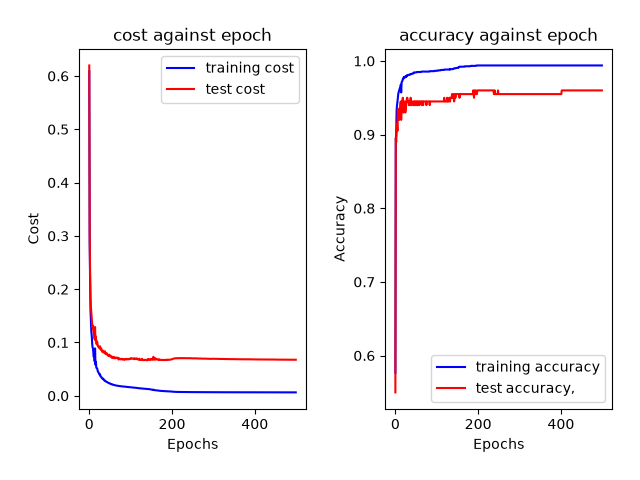
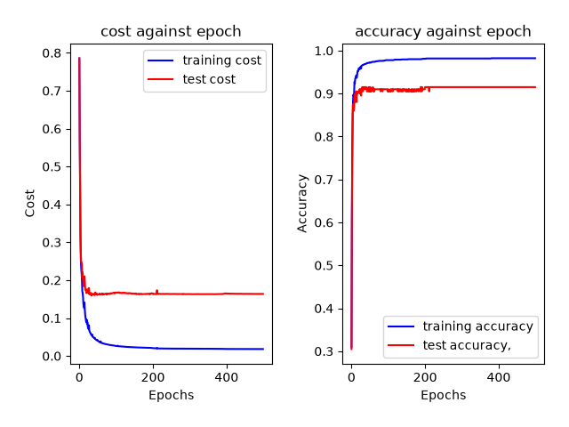
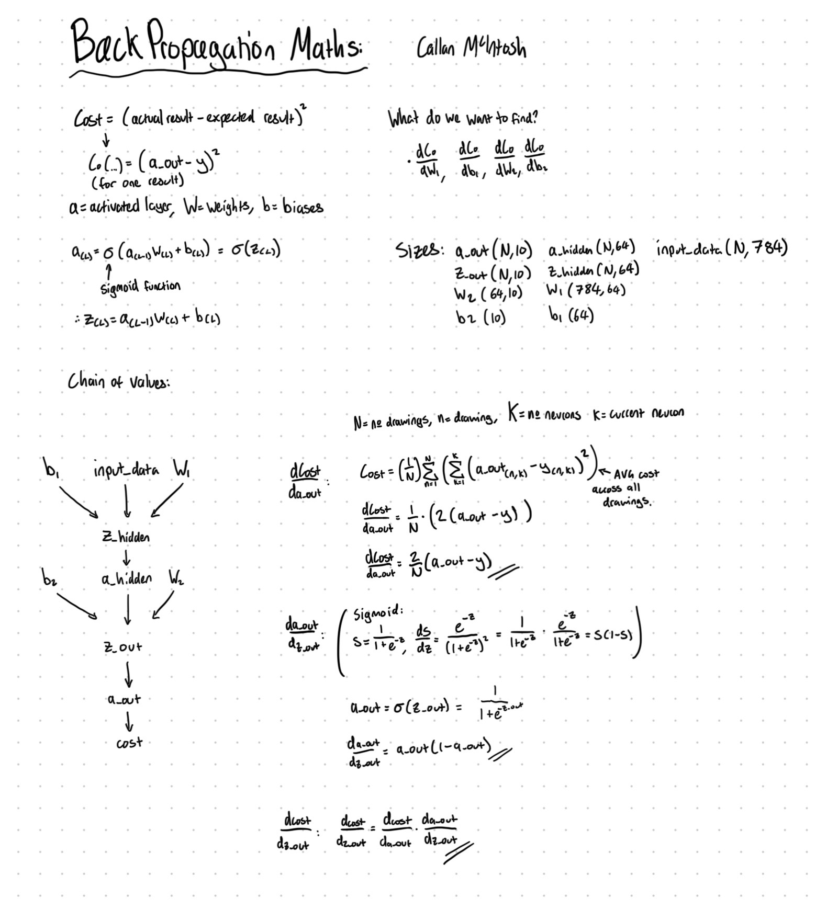
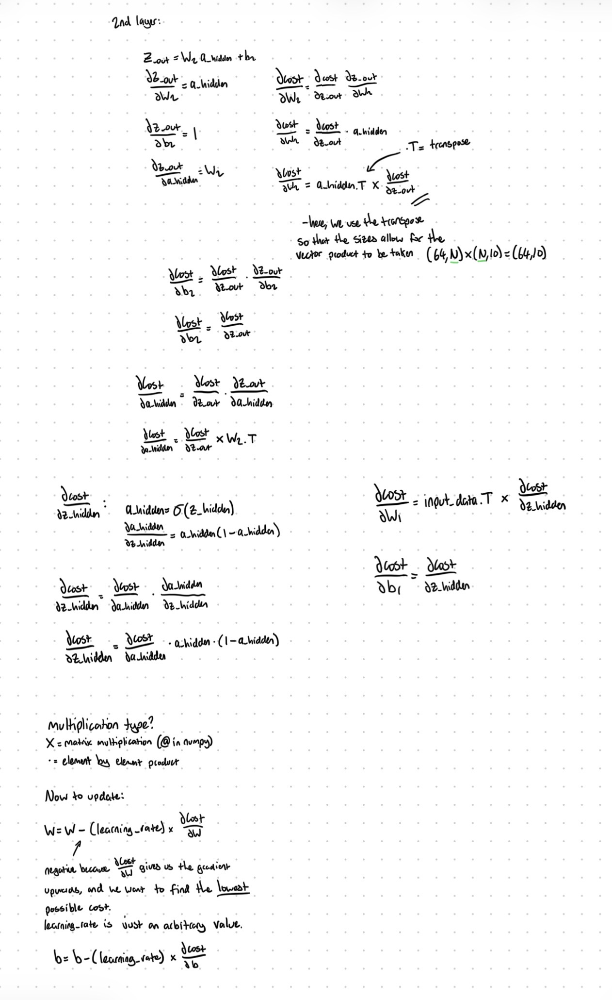

# NumPy-Neural-Network-for-handwritten-number-recognition-
a two layered neural network written in python and NumPy (no ML libraries) from scratch, trained on a dataset of 2000 images I collected myself. Test data achieved an average of around 95.5% accuracy.

## Results
for each of the following tests, I plotted graphs of training loss, test loss, training accuracy and test accuracy against epochs: 

.png)
Figure 1 shows a dataset size of 600 drawings, with centring enabled.
.png)
Figure 2 shows a dataset size of 600 drawings, with centring disabled.

Figure 3 shows a dataset size of 2000 drawings, with centring enabled.

Figure 4 shows a dataset size of 2000 drawings, with centring disabled.

## How to run
To run this yourself, make sure you have NumPy and MatPlotLib installed on your device. Use ‘collect.py’ if you wish do add your own digits to the dataset (it does take a while!), ‘train.py’ will train the network on the new dataset and produce graphs based on the results.
‘guesser.py’ is the easy way to test it yourself, where you can draw in your own digits on a canvas and see what the network thinks you’ve drawn.

## How it works
The dataset I used was an array of 28x28 images, obtained from ‘collect.py’. It’s formatted so that black, grey and white pixels have a value (activation) of 0, 0.5 and 1 respectively. The data was then centred by finding its ‘centre of mass’ and adjusting so that it lies on the centre of the grid. This helps the results by ensuring the data is consistent with each other, and so the neural network doesn’t get mixed up thinking a shape drawn on one side is a different value to one placed somewhere else on the canvas.
The network has 784 input neurons, one for each pixel of the drawings. The hidden neurons can be edited within ‘train.py’, but after some testing I found that for a single hidden layer for a project this size, 72 seemed to give the best results most consistently. However for the first tests with 600 drawings, I used just 16 hidden neurons. There are 10 output neurons, one for each value the network may have guessed. The output with the highest activation is the guess that is decided by the network.                                                             
To train the network, the data is randomly split into training batches and test batches (the ratio of which can also be configured in ‘train.py’), where training data was then fed through the network in batches of 32 to calculate the gradient descent and apply it for each batch. I figured out the maths involved in the back propagation steps below:

## Ending notes 
The clear downfall of my network is the overfitting which is clearly visible in all the result figures. This could likely be solved for the most part by increasing the size of the dataset, but this proved to be extremely time consuming (and boring!) for even getting to just 2000 drawings. 
Throughout my process I tried to limit my use of AI, but I still relied on it throughout for some things. I used an AI assistant (Claude) to come up with the starting architecture of how the network/files would be structured, review and debug code, walk through my maths derivations and assist with specific issues regarding NumPy and matplotlib syntax. It also suggested the training/data split and suggested centring to improve results. All code was still written by me. 
The educational deep learning video series by youtuber 3blue1brown proved to be of great help in initially explaining the fundamentals of a basic neural network (https://youtu.be/aircAruvnKk?si=t2gkgu-4XFrLn8mm) 
